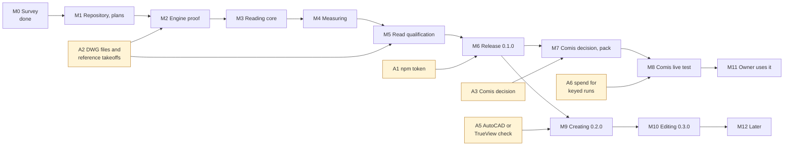

# cad-axi: master plan

| | |
| --- | --- |
| Status | Version 0.1.0 released to npm with signed provenance (2026-11-22): reading, measuring, creating and editing, with every write checked ([write matrix](write-matrix.md)). The Comis apps pack ships it since comisai/comis#4702 (merged 2026-11-22, decision D-new-159). The live gates wait for A2, the AUDIT check for A5, a keyed Comis run for A6. |
| Date | 2026-11-22 |
| Design | [`cad-axi-design.md`](cad-axi-design.md) |
| Implementation plan | [`cad-axi-implementation-plan.md`](cad-axi-implementation-plan.md) (tasks T1 to T50, test plan, CI) |

## 1. Goal

An owner sends their chief of staff a DWG or DXF file. A Comis worker reads it with `cad-axi` and answers from what the file holds: its layers, blocks and text, and lengths by system and size, each with its source, and with gaps named. When the owner asks for a change or a new drawing, the worker writes a new file that the tool has checked against what was asked, and the owner opens a draft in their own CAD.

**Done means all seven of these hold:**
1. The live gate passes L1 to L6 and L9 on the owner's real DWG files, with every measured group within 10% of a person's takeoff.
2. `cad-axi` 0.1.0 is on npm with signed provenance from this repository.
3. The Comis decision record is accepted, the apps pack ships the tool, and the `drawing-takeoff` skill routes DWG and DXF files to it.
4. A real model in Comis answers the sample drawing's questions with every length right.
5. `cad-axi` 0.2.0 creates drawings that pass both independent readers and open in AutoCAD or DWG TrueView with a clean AUDIT.
6. `cad-axi` 0.3.0 edits copies with zero lost entities, refuses files it cannot carry, and the owner opens edited copies of their own drawings without a recovery prompt.
7. The owner has asked their chief of staff a question about a real DWG, and the answer came through Comis.

## 2. Status board

Updated 2026-11-22.

| Area | Status | Evidence |
| --- | --- | --- |
| Survey of DWG engines | **Done** | Design §4: every open and closed engine compared on licence, versions, write fidelity, text, security and packaging |
| Repository and plans | **Done** | `comisai/cad-axi` is public under MIT; design, implementation plan and master plan merged in comisai/cad-axi#1 |
| Repository settings and CI | **Done** | CI on native x64 and arm64 runners since #3; branch protection, the tag rule and the npm environment applied after #3 |
| Engine proof | **Done, except T10** | [Engine proof](engine-proof.md): 47 of 47 gates on each platform and 15 of 15 independent checks; Q1, Q2, Q5, Q6 and Q8 answered. T10 waits for A2 |
| Reading (0.1) | **Built** | M3 and M4 gates pass on the sample on both platforms (#4); M5 waits for A2 |
| Release 0.1.0 | **Done** | `npm view cad-axi@0.1.0 dist.attestations` names `comisai/cad-axi`'s `release.yml` at `v0.1.0`; both engines are mode 0755 in the tarball; the install job runs it on x64 and arm64 |
| Comis pack | **Merged** | comisai/comis#4702: the apps pack pin, `drawing-takeoff` routing DWG and DXF, the new `drawing-edit` skill, decision D-new-159. The installed apps pack passed its payload proof on x64 and arm64 under gVisor, and L8 and the sign-in record were recaptured with it. M8's keyed run waits for A6 |
| Creating | **Built, in 0.1** | `create` and `create --like`; every output read again and compared; LibreDWG and ezdxf read every output in CI. The AUDIT check waits for A5 |
| Editing | **Built, in 0.1** | `edit` and `convert` behind the verified lists ([write matrix](write-matrix.md)); L7 and L8 wait for A2 and A5 |
| Owner's DWG files | Not received | A2. The drawings used to qualify `drawing-axi` were PDFs; DWG files are needed for every live gate here |

## 3. Workstreams

| ID | Workstream | Who | Scope |
| --- | --- | --- | --- |
| A | Owner actions | Owner | §7 |
| B | AXI build | Developer | T2 to T32, T38 to T50 |
| C | Live qualification | Developer, with the owner's drawings | T10, T28, T44, T50 |
| D | Comis pack | Developer, with Comis reviewers | T33 to T37, T43 |
| E | Later | Developer and owner | Design §13, phase 4 |

## 4. Milestones and gates

A milestone is done only when its gate passes. Every gate is a command or a proof.

| ID | Milestone | Stream | Depends on | Exit gate | Status |
| --- | --- | --- | --- | --- | --- |
| M0 | Survey | — | — | Engines compared; a stack chosen with its reasons and its switch conditions | **Done 2026-11-22** |
| M1 | Repository and plans | B | M0 | The plans merged; T2 settings in place | **Done 2026-11-22** (#1, #3) |
| M2 | Engine proof | B, C | M1, A2 for T10 | Both NativeAOT binaries pass `probe` and `read` on the ACadSharp samples; limits hold; Q1, Q2, Q5, Q6 settled; the private pass over the owner's DWGs is written | **Passed 2026-11-22 except T10** (#3; [engine proof](engine-proof.md)). T10 waits for A2 |
| M3 | Reading core | B | M2 | `info`, `layers`, `blocks`, `texts` and `query` exact on the sample, on both platforms | Not started |
| M4 | Measuring | B | M3 | `measure`, `runs`, `render`, `diff` and `check` exact on the sample; hostile set and independent producers pass | Not started |
| M5 | Read qualification | C | M4, A2 | The live gate passes L1 to L6 and L9; the skill dry run passes | Not started |
| M6 | Release 0.1.0 | B | M5, A1 | `npm view cad-axi dist.attestations` names this repository; the live gate passes on the installed package | **Released 2026-11-22**; the live gate waits for A2 |
| M7 | Comis decision and pack | D | M6, A3 | The decision record accepted; the pack builds and its doctor finds the exact version on x64 and arm64; the Comis merge gate passes | **Merged 2026-11-22** (comisai/comis#4702); the owner's acceptance of D-new-159 (A3) stands open |
| M8 | Comis live test | D | M7, A6 | A scripted stage with the pack installed; a keyed scenario in which a real model answers the sample's questions with every length right | Not started |
| M9 | Creating, 0.2.0 | B | M6, A5 | Every written fixture passes both independent readers; a person opens sample outputs with a clean AUDIT; the `drawing-edit` skill merged in Comis | Not started |
| M10 | Editing, 0.3.0 | B, C | M9, A2, A5 | Zero lost entities across the write matrix; L7 and L8 pass on the owner's drawings | Not started |
| M11 | The owner uses it | D | M8 | One real question about a DWG answered through the chief of staff on the owner's own install | Not started |
| M12 | Later | E | M10 | Each change by demand, with a drawn test and a live check | Later |

## 5. Dependencies

**Critical path, now:** M3 and A2. The engine proof showed the stack holds on both platforms. Reading can be built on made-up drawings now; without the owner's DWG files it cannot pass its live gate, and T10 stays open.

## 6. Schedule

These are estimates for one developer from 22 November 2026. They exclude review queues and owner actions.

| Milestone | Effort | Holds if |
| --- | --- | --- |
| M1 | Half a day | |
| M2 | Two days | NativeAOT works on x64 as it did on arm64 |
| M3 and M4 | Five days | The front end runtime copies over from `drawing-axi` unchanged |
| M5 | One to two days | A2 arrives with reference takeoffs |
| M6 | One day | A1 is done; the first publish of a new package name works |
| M7 and M8 | Two days | The Comis pack's checks accept native files inside an npm package (C9) |
| M9 | Three days | ACadSharp's writer passes both readers at AC1032 |
| M10 | Five days | The verified class list covers the classes the owner's drawings hold |

## 7. Owner actions

**A1. npm, once, about five minutes.** Done 2026-11-22. The release workflow publishes with a token and signs provenance with its own identity.
1. Sign in to npmjs.com with the account that owns `drawing-axi`.
2. Create a granular access token with read and write access to **all packages**, so that it may create the new package name `cad-axi`. A token limited to existing packages cannot publish a new one.
3. Store it as the `NPM_TOKEN` secret of this repository's `npm` environment: `gh secret set NPM_TOKEN --env npm --repo comisai/cad-axi`.
4. Tell the developer, who pushes the `v0.1.0` tag.

After the first release, the token can be narrowed to this package or replaced by trusted publishing.

**A2. DWG files.** Plumbing, drainage or fire-protection drawings as DWG, from at least two design offices, each with a person's lengths for a few systems where they exist. The same projects as earlier PDF drawings are best: the DWG and the PDF can then be compared. Files from AutoCAD MEP or similar products are useful too, to test how the tool reports what it cannot read. They stay on the owner's machine; the private live plan names them by path.

**A3. The Comis decision.** Approve the decision record that ships `cad-axi` in the apps pack beside `drawing-axi`, with one reading skill and one new `drawing-edit` skill (design §11, C1).

**A4. ODA File Converter in CI.** Decide whether this repository's CI may run ODA's free converter as a third reader. Its licence is personal and revocable and forbids service use, so the default is no.

**A5. A CAD check per writing release.** Someone with AutoCAD, or Autodesk's free DWG TrueView on Windows, opens the release's sample outputs and runs AUDIT. For M10, the owner opens edited copies of their own drawings.

**A6. Spend for keyed runs.** Authorize a keyed live run in Comis with a spend ceiling and a record, as for `drawing-axi`.

## 8. Decisions

| ID | Decision | Chosen | Decides |
| --- | --- | --- | --- |
| N1 | The engine | ACadSharp, MIT, compiled with NativeAOT; acadrust is the documented alternative (design §4.2) | Developer (decided) |
| N2 | One tool or two | Two tools behind one reading skill; `drawing-axi` stays PDF-only (design §4.3) | Developer (decided); Comis maintainers confirm in C1 |
| N3 | The name | `cad-axi`; "works with DWG and DXF files" (design §14) | Owner (asked for it) |
| N4 | Default output version | AC1032, the only version reported to round-trip clean in AutoCAD (design §8.8) | Developer (decided) |
| N5 | How writes are trusted | Refuse and prove: a verified class list before writing, a fresh re-read and comparison after (design §8.8, §8.9) | Developer (decided) |
| N6 | When a file cannot be re-saved | The overlay: a new drawing in the source's coordinates (design §8.8) | Developer (decided) |
| N7 | Real drawings in the repository | Never. Tests draw their own files | Developer (decided) |
| N8 | LibreDWG | Only as an independent producer and reader in CI; never shipped | Developer (decided) |
| N9 | ODA File Converter | Not used, unless the owner decides otherwise (A4) | Owner |
| N10 | How the engine ships | Inside the npm package, so it inherits the package's provenance; no per-platform packages | Developer (decided) |
| C1 | Which Comis pack ships it | The apps pack, beside `drawing-axi` | Comis maintainers |
| C2 | Does the skill need a connected service | No. The tool reads a local file | Comis maintainers |

## 9. Live test cadence and rules

**When to run it:**

| Run | Command | Purpose |
| --- | --- | --- |
| While changing reading, geometry, runs or sizes | `npm run live -- --plan <plan>` | Catch a regression on real drawings before review |
| Before each release | `npm run build && npm run live -- --plan <plan>` | The gate for M6, M9 and M10 |
| After each release | The same, with the installed package on `PATH` | The published bytes behave like the built ones |
| When new drawings arrive | A new plan file | A2 |

**Rules:**
- **Drawings never enter the repository,** an issue or a pull request. They belong to their makers and their clients.
- **Plans and reports are private.** Reports are gitignored, mode 0600, name files by position, and hold layer names and numbers.
- **Never in public CI.**
- **A pull request carries the summary line only,** and only if the drawings' owner allows it.
- **Edits on real drawings write copies only,** in a private folder, never beside the original.

**In Comis (M8):**
- The scripted stage and the keyed scenario use the made-up sample drawing, so the record can be public.
- The keyed scenario uses a real model. It runs only with the owner's authorization and a spend ceiling, and writes a record.

## 10. Risks

| ID | Risk | Likelihood | Impact | Mitigation | Owner |
| --- | --- | --- | --- | --- | --- |
| K1 | NativeAOT fails on x64 or on an ACadSharp path the probe did not touch | Medium | High: no engine | M2 builds both platforms and runs the whole contract suite on the binaries; the self-contained single-file build is the fallback | Developer |
| K2 | AutoCAD asks to recover files the tool writes | Medium | High: owners stop trusting writes | AC1032 by default; the human check per release; the overlay; L8 | Developer, owner |
| K3 | An edit silently loses objects | Medium | High | The verified class list refuses anything unproven; the verify loop compares every untouched entity | Developer |
| K4 | The owner's drawings hold mostly vertical-product objects no engine reads | Medium | High: little to measure | `info` says so first; the skill asks for an "Export to AutoCAD" copy; M2's private pass measures it early | Developer, owner |
| K5 | Hebrew text decodes wrongly in older files | Medium | Medium | Q2 settled in M2; `raw` kept beside `text`; decoding reported, never silent | Developer |
| K6 | A hostile file crashes or exhausts the engine | Medium | Medium | Managed code; a child process under input, heap and time limits; hostile set and fuzzing | Developer |
| K7 | A drawing's text steers the model | Low | Medium | Text safety; the skill treats text as data | Developer |
| K8 | ACadSharp's single maintainer stops | Low | Medium | The protocol and tests allow a switch to acadrust (design §4.2) | Developer |
| K9 | The Comis pack refuses native files inside an npm package | Medium | Medium: the pack waits | C9 checks it early; the engine stays inside the package so provenance covers it | Developer |
| K10 | The npm token cannot create a new package | Medium | Low: the release waits | A1 step 2 says what the token needs | Owner |
| K11 | A written drawing is taken for a checked one | Medium | High | Every write is a draft; the skill tells the owner to open it and run AUDIT | Developer, owner |
| K12 | A client's drawing leaks into a public place | Low | High | N7; the pull request template; private plans and reports | Developer |
| K13 | Trademark trouble over the name or a claim | Low | Medium | A neutral name; referential use only; the disclaimer; never write TrustedDWG (design §14) | Developer |
| K14 | No DWG files arrive | Medium | High: no live gate | Build on made-up drawings meanwhile; the gate waits for A2 | Owner |

## 11. Files

| File | Purpose |
| --- | --- |
| `docs/cad-axi-design.md` | What and why: what DWG files hold, options, architecture, commands, behaviour, safety, the Comis changes |
| `docs/cad-axi-implementation-plan.md` | How: layout, module contracts, the engine protocol, tasks T1 to T50, test plan, CI and release |
| `docs/cad-axi-master-plan.md` | When and who: milestones, gates, owner actions, decisions, risks |
| `docs/engine-proof.md` | M2's results: what the engine proof measured and what it changes |
| `README.md` | What the tool is, its status, and its rules |
| `NOTICE` | Credits and the trademark disclaimer |
